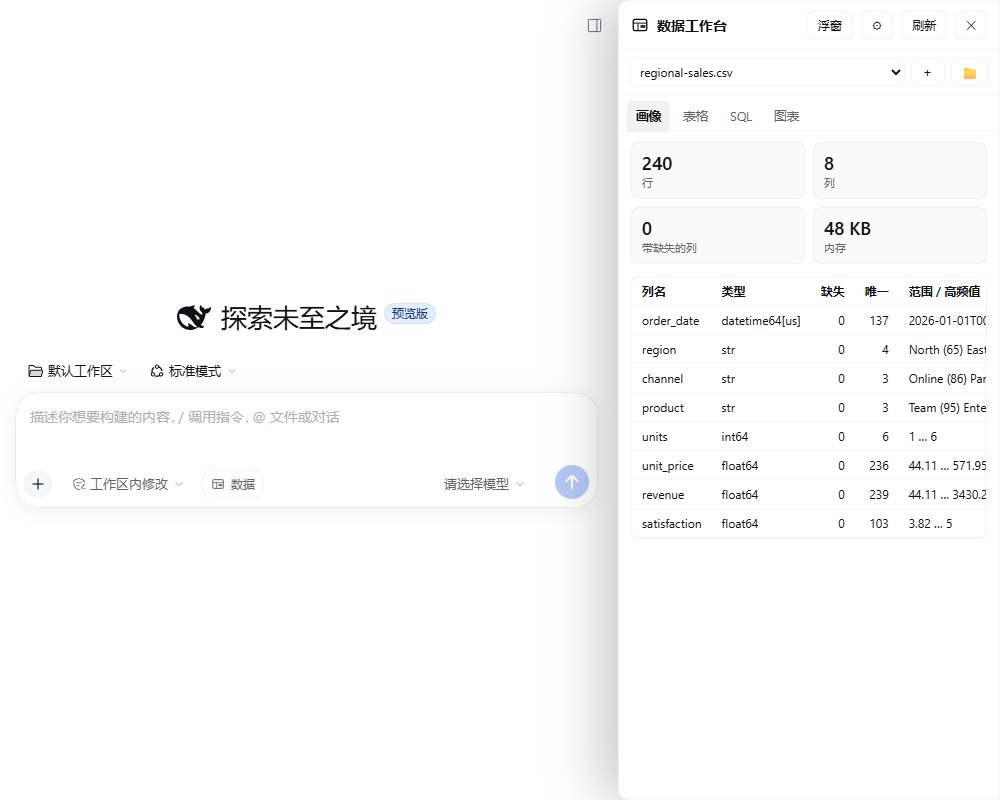
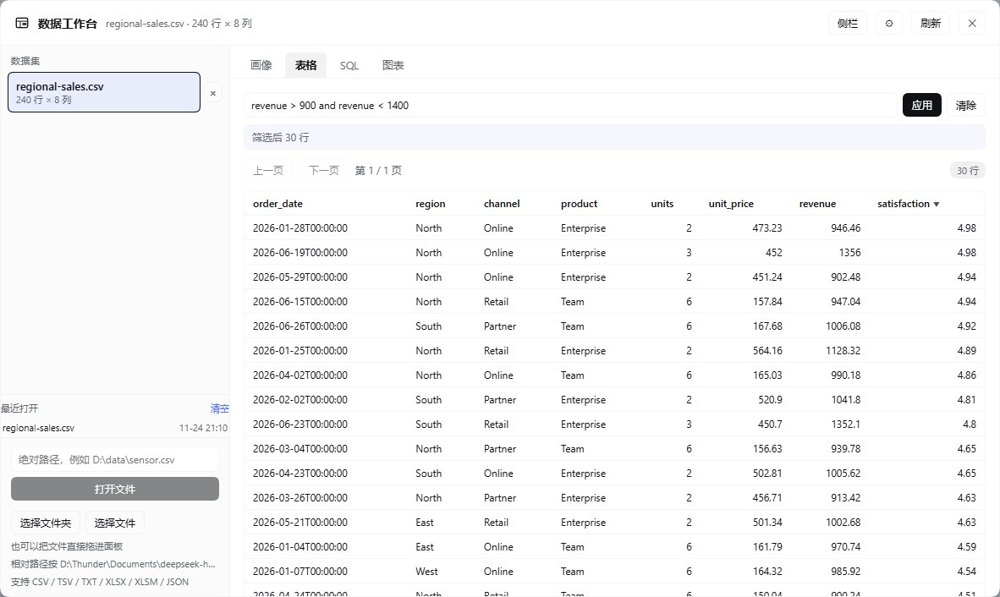
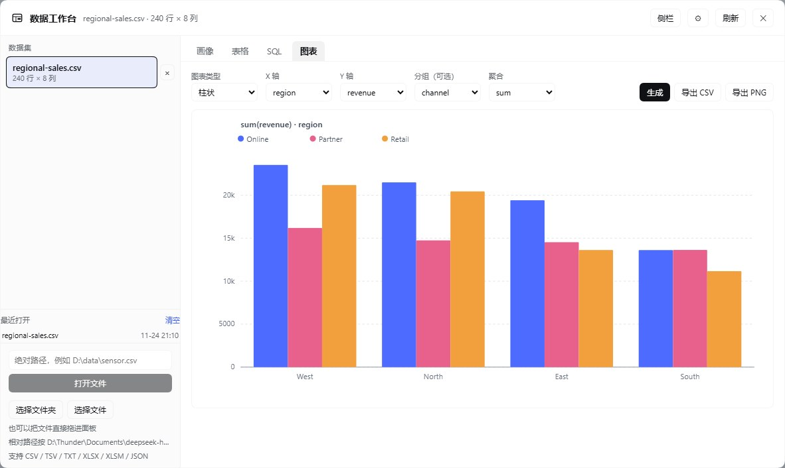

# dsh-data-console

[](https://www.npmjs.com/package/dsh-data-console)
[](LICENSE)
[](https://github.com/yasaxiwind/dsh-data-console/actions/workflows/ci.yml)

A local data console inside [DeepSeek Harness](https://github.com/deepseek-ai): open a CSV/Excel file from the conversation, understand it, query it, chart it and export it — and give the agent a small, bounded set of tools over the same data.

Everything is read on your machine. No dataset is uploaded anywhere.


## Screenshots







The screenshots use [examples/regional-sales.csv](https://github.com/yasaxiwind/dsh-data-console/blob/main/examples/regional-sales.csv),
a synthetic 240-row dataset included in this repository (no real customer data).

## Install

### From npm (recommended)

```sh
dsh plugin --profile <profile> add dsh-data-console
```

In **DSH Desktop**, open **Settings → Plugins → + Add plugin** and enter `dsh-data-console`. The desktop app manages its own profile, so install it there rather than through a separate CLI profile. Restart if the Host asks for it.

### From a tarball

```sh
dsh plugin --profile <profile> add ./dsh-data-console-1.0.4.tgz
```

### From this folder (development)

Add the folder as a local bundle in **Settings → Plugins → + Add plugin**. The bundle is installed as a link, so editing files and toggling the plugin's row reloads the host half; client changes need a window reload (`Ctrl+R`).

Compatibility: DSH 0.2.2-rc.5 or newer. Tested on DSH Desktop 0.2.2-rc.5 with the bundled Python runtime.

## What you get

- **Panel** — a `数据` / `Data` button in the composer opens the console for that session.
  - **Move and dock** — drag the header to move the window; releasing near the right edge (or clicking **侧栏**) docks it as a right sidebar that shrinks the conversation instead of covering it. Drag the sidebar's left edge to resize (280–560 px), drag its header left to undock, double-click the header to toggle. Mode, position and width are remembered in `localStorage`. In the desktop app the sidebar starts below the window title bar (read from `--dsh-windows-titlebar-height`), so its buttons stay clear of the native minimize/maximize/close controls; floating panels are clamped below that strip too.
  - **Open** by absolute/relative path, or with the OS dialogs: **选择文件夹** picks a folder and lists its data files in the sidebar, **选择文件** opens one, and dropping a file onto the panel imports it (the panel takes over the drop and clears DSH's attachment overlay, so the composer does not attach it). The same path and sheet reuse one open dataset.
  - **Imported copies** — dropped or selected files are copied to `$DSH_HOME/data-console/cache/<content-hash>/` so the Python sidecar gets a real path; identical bytes reuse the copy and the same open dataset. Copies older than 7 days are pruned at startup; uploads are capped at 100 MB (use the path field for larger files).
  - **Profile** — rows, columns, dtype, missing values, unique counts, ranges/top values, and the in-memory footprint. Files larger than the row limit say so.
  - **Table** — 50 rows per page; click a header to sort ascending, again descending, again to clear.
  - **SQL** — query the loaded table as `data` in an in-memory SQLite database; every other open dataset is available by its id (`ds2`, `ds3`, …) so tables can be joined; results are paged in the panel.
  - **Table filter** — type a SQL `WHERE` expression (`value > 50 and channel = 'A1'`), apply it to the table, sort inside the filtered rows and clear it again.
  - **Charts** — line, bar, scatter, histogram, box and heatmap, computed by the Python sidecar and drawn as SVG (no matplotlib); export the chart as CSV or a 2× PNG.
  - **Export** — the whole table or a query result as CSV (UTF-8 with BOM) or XLSX.
  - **Sessions** — a dataset opened by a session is listed first for it and tagged *other session* elsewhere; with several datasets open, a tool without an explicit id picks the session's own.
  - **Restore & recent** — the datasets open at shutdown (up to 8) are reopened in the background on the next start, and the last 20 opened files appear under *Recent* in the sidebar (one click to reopen, clearable). Bookkeeping lives in `$DSH_HOME/data-console/datasets.json`.
  - **Settings** — gear button: max file size, max loaded rows, default chart type/aggregation, and an optional Python path. Stored in `$DSH_HOME/data-console/settings.json`.

## Agent tools

| Tool | Purpose |
|---|---|
| `data_open` | Load a CSV/TSV/TXT/XLSX/XLSM/JSON file and return its profile |
| `data_list` | List open datasets (id, name, shape, path, owner session) |
| `data_profile` | Column profile for one dataset, optionally a subset of columns |
| `data_query` | Run SQL over the open datasets (`data` plus `ds<id>` tables); returns at most 50 rows and 80 chars per cell |
| `data_export` | Write the table or one query result to CSV/XLSX and return the path |

Tool output is bounded on purpose: the model gets a compact summary, not a full dump.

## Requirements

- Python with `pandas` and `openpyxl`. The plugin uses, in order:
  1. `pythonPath` from settings;
  2. `DSH_PYTHON`;
  3. the bundled DSH runtime (`$DSH_HOME/dsh-runtimes/*/dependencies/python`);
  4. `python` / `python3` / `py` on `PATH`.
- DSH 0.2.2-rc.5 or newer.

## Privacy and safety

- Files are read locally by the Python sidecar; the plugin has no telemetry and no upload path.
- SQL runs on an in-memory read-only SQLite copy (`PRAGMA query_only = ON`); the source file is never modified.
- Panel routes are authenticated same-origin routes under `/api/data-console/`.
- See [SECURITY.md](SECURITY.md) for details and reporting.

## Limits and notes

- Datasets live in memory; restarting DSH clears the list (files are untouched).
- Default limits: 256 MB per file, 5,000,000 loaded rows. Both are configurable in the settings (file size cap is also the host `maxFileMB` config default).
- CSV/TSV/TXT are read in 200k-row chunks and stop at the row limit with a `truncated` flag; Excel/JSON are read whole then truncated.
- Legacy `.xls` is rejected — save it as `.xlsx` first.
- SQL results are fetched in full up to 200 rows and paged in the panel; tool queries stay at 50.
- Dropped/selected files are copied into the cache and opened from there; the cache is pruned at startup (7 days) and is not backed up.
- Table filters are SQL `WHERE` fragments evaluated on the host; they combine with sorting but do not change the dataset's profile or charts.
- Charts cap line/bar at 400 points per series, scatter at 1,500 points, heatmaps at 20×12 cells, box plots at 12 groups.
- The Python sidecar exits after 10 minutes idle. Dataset metadata stays in the Host, and the next table/chart/SQL/export call reopens each dataset under its existing id (a deleted file produces a clear error instead of an empty view).
- In sidebar mode the panel reserves its width by setting `margin-right` on the conversation column; windows narrower than 900 px make it a full-width drawer, and the dataset list collapses into a select plus open buttons.
- The panel is a frame overlay, not a conversation tab.

## Tests

- `npm test` — JavaScript syntax checks and the Python sidecar suite (14 protocol tests: open/profile/preview/filter/query/multi-table/read-only/charts/export/truncation/GB18030/reopen).
- `npm run test:routes` — exercises `open`/dedupe/`meta`/`preview`/filter/`query`/`settings`/`close` against a running Host; skips cleanly when the Host is unreachable or no browser-session credentials exist. Set `DSH_WEB_URL` to target another port. Close other GUI tabs of the same Host first: DSH keeps one browser session per authority, and a live tab can invalidate a minted cookie mid-run.
- `npm run verify:package` — checks the publishable manifest, locales, detail documents, icon, exports and file list.
- `npm run market:build` — regenerates `market/index.json` (format-1 plugin market index).

The acceptance record and screenshots of each milestone are in [VERIFICATION.md](VERIFICATION.md).

## Release

See [RELEASE.md](RELEASE.md) for the npm, GitHub, plugin-market and catalog steps. The changelog is in [CHANGELOG.md](CHANGELOG.md).

## Distribution

- **npm** — `dsh-data-console` on the public registry (and automatically on the
  npmmirror mirror for Chinese networks). Install with the commands above.
- **DSH plugin market index** — [`market/index.json`](market/index.json) is a
  format-1 index. Host it on any https URL (for example raw GitHub, jsDelivr or
  GitHub Pages) and add it in **Plugins → Discover → Index sources**:
  `https://cdn.jsdelivr.net/gh/yasaxiwind/dsh-data-console@v1.0.4/market/index.json`.
- **awesome-dsh-plugin catalog** — the curated catalog behind the
  [dsh-market](https://dshmarket.com) app and
  [awesome-dsh-plugin.com](https://awesome-dsh-plugin.com); listing there makes
  the plugin discoverable in the community market.
- **GitHub Release tarball** — `dsh-data-console-1.0.4.tgz` attached to the
  `v1.0.4` release, installable with `dsh plugin add ./…tgz`.

See [RELEASE.md](RELEASE.md) for the exact publish steps.

## License

[MIT](LICENSE)
